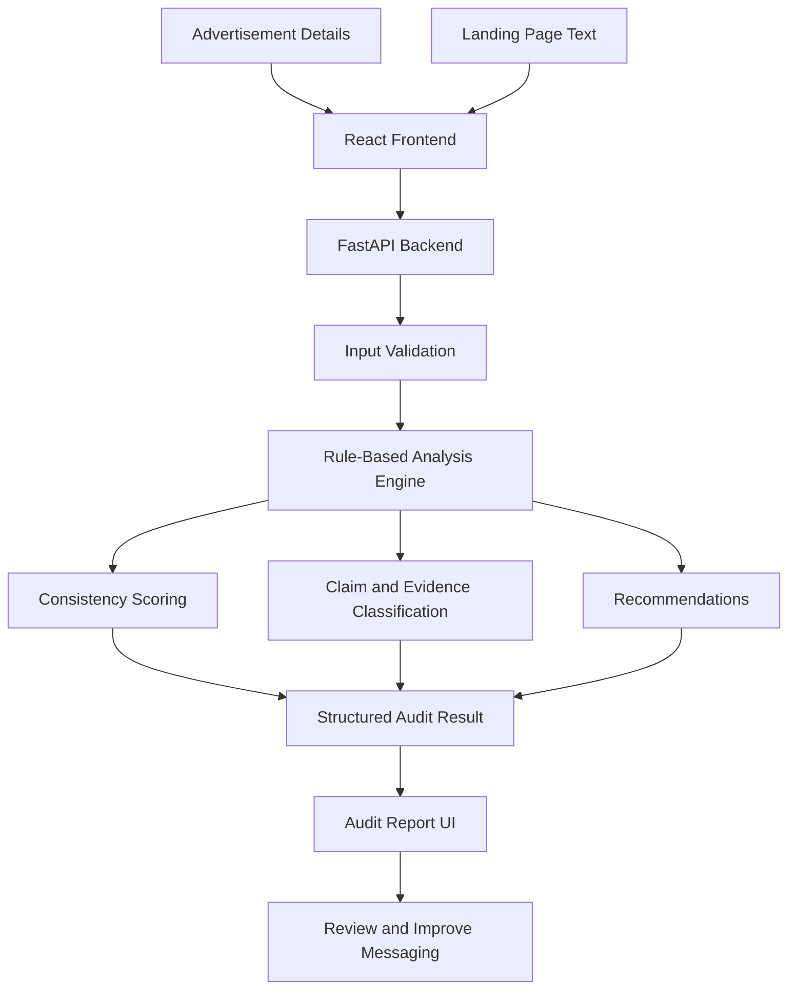

# 🚀 AdMatch AI
### Find the Gap Between Your Ad and Your Landing Page

**AdMatch AI** is a full-stack web application designed to identify potential mismatches between advertisement copy and landing-page content. It compares advertising claims with available landing-page text, highlights claims that are missing or only partially supported, and recommends improvements to make campaign messaging more consistent.

The goal is simple: **when an advertisement makes a promise, the landing page should clearly support that promise.**

🔗 **Existing Project:** [AdMatch AI on GitHub](https://github.com/SanjuvigasiniRK/admatch-ai)

> **Project Status:** MVP — actively being developed  
> **Analysis Method:** Deterministic, rule-based text matching  
> **Application Type:** Full-stack web application

---

## 📌 Table of Contents

- [Problem Statement](#-problem-statement)
- [Our Solution](#-our-solution)
- [Key Features](#-key-features)
- [How It Works](#-how-it-works)
- [Technology Stack](#️-technology-stack)
- [System Architecture](#️-system-architecture)
- [Project Structure](#-project-structure)
- [Getting Started](#-getting-started)
- [API Endpoints](#-api-endpoints)
- [Example Analysis](#-example-analysis)
- [Testing](#-testing)
- [Current Limitations](#️-current-limitations)
- [Future Enhancements](#-future-enhancements)
- [Team Contributions](#-team-contributions)
- [Security](#-security)
- [License](#-license)

---

## 🎯 Problem Statement

Digital advertisements often make promises that are not clearly reflected on their landing pages. This mismatch can confuse visitors, reduce confidence in the campaign, and make it harder for users to understand what is actually being offered.

Manually checking every advertisement against its landing page can also be time-consuming.

Existing text comparisons may overlook the difference between a claim that is explicitly supported, one that is only partially mentioned, and one for which no supporting text has been provided.

AdMatch AI addresses this problem by analyzing advertisement copy alongside available landing-page content and producing structured findings that help users identify messaging gaps.

## 💡 Our Solution

AdMatch AI provides a structured audit workflow that compares an advertisement with its associated landing-page text.

Users can provide the advertisement headline, body copy, call-to-action, landing-page URL, target audience, campaign goal, industry, and landing-page content.

The application evaluates textual alignment, calculates consistency indicators, classifies findings, and suggests improvements.

Rather than displaying only a score, AdMatch AI aims to make its results understandable by showing the claim being assessed, available supporting text, the classification of the finding, and a suggested correction.

**The current implementation uses rule-based text matching. Its scores are indicators of textual alignment, not proof that a claim is true or a prediction of advertising performance.**

## ✨ Key Features

### 📝 1. Advertisement Analysis

Collects campaign information, including:

- Advertisement headline
- Advertisement body copy
- Call-to-action (CTA)
- Landing-page URL
- Target audience
- Campaign goal
- Industry
- Landing-page text

### 🔍 2. Claim-to-Content Comparison

Compares advertisement claims with the supplied landing-page content to identify:

- Claims with matching textual evidence
- Claims with partial textual support
- Claims for which supporting text was not found

A missing textual match does not automatically mean the claim is false.

### 📊 3. Consistency Scoring

Produces indicators across three dimensions:

- **Message Consistency:** Measures wording overlap between advertisement copy and landing-page content.
- **Promise Fulfillment:** Evaluates how the supplied text supports the claims being checked.
- **CTA Alignment:** Checks the wording alignment between the call-to-action and landing-page content.

These indicators are generated using the current analysis rules. They should not be interpreted as conversion-rate predictions or independent verification of advertising claims.

### 🧾 4. Evidence-Based Findings

Provides structured findings that can include:

- The claim being evaluated
- Evidence classification
- Supporting text, when available
- Explanation of the finding
- Priority level
- Suggested correction

### 💡 5. Improvement Recommendations

Suggests changes to help align advertisement copy with the information available on the landing page.

Recommendations may include revised wording and explanations of the identified gap.

### 📚 6. Audit Dashboard and History

The application includes pages for:

- Dashboard
- New audit creation
- Audit history
- Individual audit reports
- Settings

The backend provides endpoints for creating, retrieving, and deleting audits. Persistence depends on the active storage implementation.

### 🧪 7. Demo and Live Modes

- **Demo mode:** Uses browser-side sample behavior and keyword matching.
- **Live mode:** Sends audit requests to the configured FastAPI backend and displays its response.

These modes use different execution paths. Demo results should not be confused with live backend analysis.

---

## 🔄 How It Works

1. The user enters advertisement details and landing-page text.
2. The React frontend collects and validates the input.
3. In live mode, the frontend sends the request to the FastAPI backend.
4. The backend passes the supplied content to the deterministic analysis engine.
5. The engine evaluates textual matches and classifies findings.
6. The analysis produces consistency indicators, evidence, and recommendations.
7. The frontend displays the audit report.
8. Audit records can be retrieved through the backend API.

### Workflow Diagram



---

## 🛠️ Technology Stack

| Technology | Purpose |
|---|---|
| React | Frontend user interface |
| Vite | Frontend development and build tooling |
| React Router | Page navigation |
| Lucide React | Interface icons |
| Python | Backend implementation |
| FastAPI | REST API |
| Uvicorn | ASGI server |
| Pydantic | Request validation |
| HTML and CSV | Landing-page snapshots and advertisement data |
| Git and GitHub | Version control and collaboration |

---

## 🏗️ System Architecture

AdMatch AI follows a frontend-backend architecture.

### Frontend Layer

The React application provides the dashboard, audit creation form, history, settings, and audit report interfaces.

### API Layer

FastAPI exposes endpoints for submitting audits, retrieving audit results, deleting audit records, and checking dataset status.

### Analysis Layer

The deterministic analysis engine processes the supplied text, evaluates matching rules, generates consistency indicators, classifies findings, and prepares recommendations.

### Data Layer

The application can use advertisement records, local landing-page snapshots, and the active backend's audit storage implementation.

---

## 📂 Project Structure

The following is the intended high-level structure. Confirm the actual filenames and folders in the repository before relying on this tree.

```text
admatch-ai/
├── frontend/
│   ├── src/
│   │   ├── components/
│   │   ├── pages/
│   │   └── ...
│   ├── package.json
│   └── ...
├── backend/
│   ├── app/
│   │   └── main.py
│   ├── data/
│   │   └── dataset/
│   │       ├── ads.csv
│   │       ├── README.md
│   │       └── landing_page_snapshots/
│   ├── requirements.txt
│   └── ...
├── .gitignore
└── README.md
```

---

## ⚙️ Getting Started

Follow these instructions to run the application locally.

### Prerequisites

Install the following:

- Git
- Python 3.11, or a version supported by the project
- Node.js and npm
- Visual Studio Code (recommended)

### 1. Clone the Repository

Clone the existing project:

```bash
git clone https://github.com/SanjuvigasiniRK/admatch-ai.git
cd admatch-ai
```

If you are using the hackathon organization's repository, replace the URL with that repository's clone URL.

### 2. Set Up the Backend

Open a terminal in the project root:

```bash
cd backend
```

Create a virtual environment:

```bash
python -m venv .venv
```

Activate it on Windows Command Prompt:

```cmd
.venv\Scripts\activate.bat
```

On Windows PowerShell:

```powershell
.\.venv\Scripts\Activate.ps1
```

On macOS or Linux:

```bash
source .venv/bin/activate
```

Install the dependencies:

```bash
python -m pip install -r requirements.txt
```

Start the backend from the `backend` directory:

```bash
python -m uvicorn app.main:app --reload
```

If the project's actual entry point differs, use the module path defined in the code.

### 3. Verify the Backend

Open the following addresses in your browser:

- API documentation: [http://127.0.0.1:8000/docs](http://127.0.0.1:8000/docs)
- Backend root: [http://127.0.0.1:8000/](http://127.0.0.1:8000/)
- Dataset status: [http://127.0.0.1:8000/api/dataset](http://127.0.0.1:8000/api/dataset)

The available endpoints and their actual responses can be inspected through Swagger.

### 4. Set Up the Frontend

Open a second terminal at the project root:

```bash
cd frontend
```

Install the frontend dependencies:

```bash
npm install
```

Start the Vite development server:

```bash
npm run dev
```

Open the local URL printed in the terminal. Vite commonly uses:

[http://localhost:5173](http://localhost:5173)

Keep the frontend and backend running while testing live mode.

### 5. Verify the Complete Workflow

1. Open the frontend.
2. Enter sample advertisement details.
3. Provide the corresponding landing-page text.
4. Submit an audit in live mode.
5. Check that the backend returns an audit result.
6. Review the consistency indicators, findings, and recommendations.
7. Open the audit report and history pages.
8. Verify that the displayed results match the backend response.

---

## 🔌 API Endpoints

The following endpoints are documented for the current backend implementation.

**Base URL:** `http://127.0.0.1:8000`

| Method | Endpoint | Purpose |
|---|---|---|
| POST | `/api/audits` | Create an audit |
| GET | `/api/audits/{audit_id}` | Retrieve an audit |
| DELETE | `/api/audits/{audit_id}` | Delete a specific audit |
| DELETE | `/api/audits` | Delete all audits |
| GET | `/` | Access the backend root |
| GET | `/api/dataset` | Check dataset status |

### Example: Create an Audit

**Request:** `POST /api/audits`

Example request body:

```json
{
  "headline": "Upgrade Your Skills with AI",
  "body": "Learn practical AI skills through hands-on projects.",
  "cta": "Start Learning Today",
  "url": "https://example.com/ai-course",
  "audience": "College students",
  "goal": "Increase sign-ups",
  "industry": "Education",
  "landingPageText": "Learn AI through practical projects and build your portfolio."
}
```

A successful response is expected to return a structured audit record. The actual response schema should be checked in Swagger and the backend source code.

Use the returned audit ID to retrieve the record:

```text
GET /api/audits/{audit_id}
```

**Caution:** The endpoint `DELETE /api/audits` is destructive and should only be used when intentionally clearing all stored audits.

---

## 📊 Example Analysis

Consider this advertisement:

**Headline:** Upgrade Your Skills with AI

**Advertisement Copy:** Learn practical AI skills through hands-on projects.

**Call-to-Action:** Start Learning Today

**Supplied Landing-Page Text:** Learn AI through practical projects and build your portfolio.

An illustrative analysis could look like this:

| Check | Possible finding |
|---|---|
| AI learning | Textual alignment detected |
| Hands-on projects | Related wording appears in the supplied text |
| Portfolio development | Supporting wording is available |
| CTA alignment | Depends on the actual matching rules |

The engine evaluates wording based on its implemented rules. It does not establish whether the course actually provides the advertised experience.

To demonstrate the actual scoring behavior, run this example against the application and capture the real response.

---

## 🧪 Testing

The following checks are recommended for validating the MVP.

### Functional Testing

- Submit an audit with matching advertisement and landing-page text.
- Submit an audit with partially supported claims.
- Submit an audit with claims that are absent from the supplied text.
- Retrieve an audit using its returned ID.
- Check behavior for invalid input.
- Verify the frontend displays the backend response correctly.

### Dataset Testing

The project documentation describes a dataset structure containing advertisement records and local landing-page HTML snapshots.

Expected location:

```text
backend/data/dataset/
├── ads.csv
├── README.md
└── landing_page_snapshots/
```

Verify that the files exist, that the advertisement records map correctly to the snapshots, and that the dataset-status endpoint reports the actual available data.

### Suggested Future Automated Tests

- Backend endpoint tests
- Input-validation tests
- Analysis-rule unit tests
- Frontend integration tests
- Regression tests for scoring and evidence classification

These automated tests should be added and run before claiming full test coverage.

---

## ⚠️ Current Limitations

AdMatch AI is an MVP with the following limitations:

- **Rule-based analysis:** The current engine does not use an LLM to interpret claims.
- **Limited semantic understanding:** Similar words do not necessarily imply equivalent meaning.
- **Incomplete evidence:** A claim missing from the supplied text may be supported elsewhere on the website.
- **No conversion prediction:** The consistency score does not predict clicks, sales, or conversion rates.
- **No legal verification:** Results do not establish compliance with advertising laws.
- **Website extraction:** Dynamically rendered or protected website content may not be available.
- **Dataset coverage:** Results depend on the quality and completeness of the supplied content.
- **Storage behavior:** Audit persistence depends on the active backend storage implementation.
- **Production readiness:** Additional security, authentication, monitoring, deployment, and testing work is required before production use.

---

## 🚀 Future Enhancements

The following are planned improvements, not claims about features already completed.

- [ ] Add semantic claim comparison using an LLM.
- [ ] Improve website fetching and HTML content extraction.
- [ ] Highlight exact locations of supporting evidence on landing pages.
- [ ] Expand the dataset and evaluate the engine against more examples.
- [ ] Improve scoring and severity classification.
- [ ] Add search and filtering to audit history.
- [ ] Add automated frontend and backend tests.
- [ ] Introduce authentication and access control.
- [ ] Improve logging, monitoring, and error handling.
- [ ] Add a deployment workflow and continuous integration.

---

## 👥 Team Contributions

AdMatch AI can be developed collaboratively through clearly separated responsibilities.

- **Frontend Development:** User interface, audit forms, dashboard, and report presentation.
- **Backend Development:** API endpoints, request validation, audit operations, and storage integration.
- **Analysis and Integration:** Matching rules, evidence classification, scoring, recommendations, and end-to-end testing.

Update this section with the actual team members and their contributions before submitting the project. Do not assign work to a member unless they contributed to it.

---

## 🔐 Security

- Never commit API keys, passwords, access tokens, or private configuration files.
- Keep `.env` files and local virtual environments out of version control.
- Validate user-provided content before processing it.
- Treat externally sourced website content as untrusted input.
- Protect destructive operations and avoid exposing sensitive audit data.
- Review audit findings manually before making advertising decisions.

---

## 📄 License

A license has not yet been specified. Add a `LICENSE` file and update this section after deciding the project's licensing terms.

---

## 👨‍💻 About the Project

AdMatch AI explores how evidence-based text analysis can help marketers and content creators identify inconsistencies between advertising promises and landing-page messaging.

The project combines a React frontend, a FastAPI backend, and a deterministic analysis engine to produce structured audit results, traceable findings, and practical recommendations.

🔗 **GitHub:** [https://github.com/SanjuvigasiniRK/admatch-ai](https://github.com/SanjuvigasiniRK/admatch-ai)

⭐ If you find this project useful, explore the repository and share your feedback.

**Built to make advertising messages clearer, more consistent, and easier to review.**
