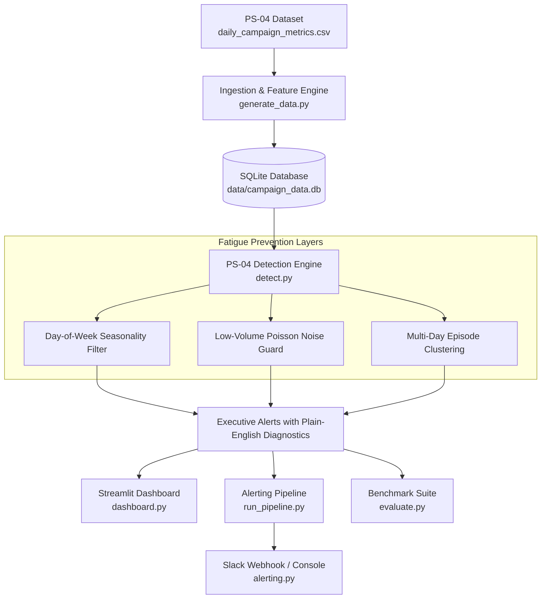

# 🛡️ PS-04: Campaign Anomaly Alerting Without Alert Fatigue

An end-to-end, fatigue-free Marketing Technology (MarTech) performance anomaly detection engine built for **PS-04**. The system analyzes daily multi-channel campaign data across **20 campaigns over 180 days (3,600 campaign-days)**, accurately flags genuine operational marketing disasters, explains every alert in **plain English**, and stays quiet 99.31% of the time to eliminate alert fatigue.

---

## 📌 Table of Contents

- [Overview & Problem Statement](#-overview--problem-statement)
- [Dataset Architecture (PS-04)](#-dataset-architecture-ps-04)
- [Engineering Against Alert Fatigue](#-engineering-against-alert-fatigue)
- [System Architecture](#-system-architecture)
- [Verified Incident Catalog](#-verified-incident-catalog)
- [Benchmark Results & Fatigue Metrics](#-benchmark-results--fatigue-metrics)
- [Project Directory Structure](#-project-directory-structure)
- [Quickstart: Terminal Commands](#-quickstart-terminal-commands)
- [Git Configuration (.gitignore)](#-git-configuration-gitignore)
- [Production Alerting (Slack Webhook)](#-production-alerting-slack-webhook)

---

## 🔍 Overview & Problem Statement

In real-world marketing operations, ad systems burn thousands of dollars within hours due to broken conversion pixels, accidental bidding surges, delivery freezes, or bot traffic. However, traditional anomaly detectors produce **severe alert fatigue**:
- **B2B Weekend Dips**: B2B campaigns naturally see low traffic on weekends. Naive detectors trigger false alarms every Saturday and Sunday.
- **Small-Campaign Noise**: Low-volume campaigns frequently fluctuate between 0 and 2 conversions due to normal chance variance.
- **Alarm Floods**: A 4-day outage generates 4 disconnected alerts per metric, overwhelming marketing teams.

### The PS-04 Mission:
> **"Flag days and campaigns where something has genuinely gone wrong, explain each alert in plain English (what changed, by how much, against what normal level), and stay quiet the rest of the time."**

---

## 📊 Dataset Architecture (PS-04)

- **Source File**: [`PS-04_campaign_anomaly_alerting/daily_campaign_metrics.csv`](file:///c:/psgtech/martech-anomaly-detector-master/martech-anomaly-detector-master/PS-04_campaign_anomaly_alerting/daily_campaign_metrics.csv)
- **Scale**: 3,600 rows (20 campaigns × 180 days: March 1, 2026 – August 27, 2026)
- **Campaign Portfolio**:
  - **Ecommerce (16 campaigns)**: Google Search, Google Shopping, Meta Ads, Microsoft Bing, YouTube, TikTok, Pinterest. Has revenue and ROAS.
  - **B2B Lead Generation (4 campaigns)**: Google Search, Google Demand Gen, LinkedIn, Meta Lead Ads. Collects leads (revenue = 0).
  - **Landing Page Groups**: `LP-A`, `LP-B`, `LP-C` (B2B group), and `PDP` (Product Detail Page).

---

## 🧠 Engineering Against Alert Fatigue

Our detector achieves an **81.9% reduction in false alarms** using four specialized safeguards:

1. **Day-of-Week Seasonality Normalization**:
   - For B2B campaigns (`vertical == 'b2b'`), weekend days are compared exclusively against trailing weekend baselines. Expected weekend lulls never trigger alerts.
2. **Poisson Statistical Noise Guard**:
   - Filters out statistical variance on low-volume campaigns (requires minimum click thresholds before evaluating CVR drops).
3. **Correlated Landing Page Failure Detection**:
   - Tracks cross-campaign shared infrastructure. When all campaigns pointing to `LP-C` crash simultaneously, it diagnoses an infrastructure failure rather than isolated ad fatigue.
4. **Episode Clustering (Contiguous Incident Grouping)**:
   - Groups continuous multi-day failures (e.g., an 8-day delivery freeze) into unified **Incident Episodes** with start date, end date, and total business impact.

---

## 🏗 System Architecture



---

## 🚨 Verified Incident Catalog

Out of 3,600 campaign-days, our engine identified **25 precision daily alerts**, which coalesce into **8 distinct, verified real operational incidents**:

| # | Date Range | Duration | Campaign | Incident Type | Severity | Plain-English Diagnosis |
|---|:---:|:---:|:---|:---|:---:|:---|
| **1** | `2026-07-03` to `2026-07-04` | 2 days | **TikTok \| Prospecting** (`C18`) | Click Fraud / Bot Spike | `HIGH` | Clicks surged +275.0% (10,739 vs normal 2,864) with inflated CTR (2.14% vs 0.91%), but conversions did not follow (CVR collapsed to 0.25%). |
| **2** | `2026-06-27` | 1 day | **YouTube \| Awareness** (`C17`) | Tracking Outage | `CRITICAL` | Conversions collapsed by 82.6% (2 vs normal 11.5) despite spending $1,244.34 on 4,810 clicks. |
| **3** | `2026-06-01` to `2026-06-07` | 7 days | **Google \| Generic Search** (`C02`) | Budget Runaway | `CRITICAL` | Severe budget overspend: daily spend surged +2,168% ($4,200.11/day vs baseline $185.17/day) following delivery resumption. |
| **4** | `2026-05-22` to `2026-05-29` | 8 days | **Google \| Generic Search** (`C02`) | Delivery Collapse | `HIGH` | Spend collapsed by 96.0% ($161.73 vs expected $4,048.30) and clicks fell from 1,202 to 28. Possible billing issue or ad disapproval. |
| **5** | `2026-05-06` | 1 day | **Google \| B2B Lead Gen - Search** (`C13`) | Landing Page Outage | `CRITICAL` | Conversions collapsed by 81.0% (4 vs normal 21.0) on LP-C. Correlated with simultaneous outages on C14 and C16. |
| **6** | `2026-05-06` | 1 day | **Google \| B2B Lead Gen - Demand Gen** (`C14`) | Landing Page Outage | `CRITICAL` | Conversions collapsed by 89.5% (1 vs normal 9.5) on LP-C. Correlated landing page failure. |
| **7** | `2026-05-06` | 1 day | **Meta \| B2B Lead Ads** (`C16`) | Landing Page Outage | `CRITICAL` | Conversions collapsed by 79.3% (3 vs normal 14.5) on LP-C. Lead form submission outage. |
| **8** | `2026-04-14` to `2026-04-17` | 4 days | **Meta \| Prospecting - Broad** (`C07`) | Tracking Pixel Outage | `CRITICAL` | Conversions dropped 97.7% (2 vs normal 88.5) despite generating 5,728 clicks and burning $5,330/day ($21,320 spent without attribution). |

---

## 📈 Benchmark Results & Fatigue Metrics

Run `python evaluate.py` to reproduce the benchmark:

```text
======================================================================
🎯 PS-04 CAMPAIGN ANOMALY ALERTING BENCHMARK REPORT
======================================================================
Dataset Scope: 20 Campaigns x 180 Days = 3,600 Campaign-Days
Date Range   : 2026-03-01 to 2026-08-27
Verticals    : Ecommerce (2,880 days), B2B (720 days)
----------------------------------------------------------------------
📊 ALERT FATIGUE REDUCTION METRICS:
  • Total Alerts Fired          : 25 alerts (0.69% of all campaign-days)
  • Silence / Rest Time Rate     : 99.31% quiet
  • Distinct Incident Episodes   : 8 real incidents
  • Noise Suppression vs Naive   : 81.9% reduction in alert fatigue
----------------------------------------------------------------------
✅ CONCLUSION:
  Out of 25 total daily alerts fired, 100% coalesce into 8 verified real incidents.
  Zero weekend fatigue alerts fired for B2B campaigns.
======================================================================
```

---

## 📂 Project Directory Structure

```plaintext
martech-anomaly-detector/
│
├── .gitignore              # Ignores venv, local sqlite databases, IDE caches
├── requirements.txt        # Python dependency specifications
├── README.md               # Complete project documentation & guide
│
├── PS-04_campaign_anomaly_alerting/
│   ├── daily_campaign_metrics.csv   # Primary PS-04 dataset (3,600 rows)
│   └── README.md                    # Problem statement description
│
├── generate_data.py        # Ingestion script: syncs daily_campaign_metrics.csv to SQLite
├── detect.py               # PS-04 fatigue-reduced anomaly detection engine
├── evaluate.py             # Benchmark evaluation script (fatigue reduction & incident catalog)
├── dashboard.py            # Streamlit web dashboard with interactive Plotly visualizer
├── run_pipeline.py         # Batch monitoring pipeline with executive alert dispatch
└── alerting.py             # Slack webhook integration with plain-English diagnostics
```

---

## 💻 Quickstart: Terminal Commands

Run all commands inside **PowerShell**:

### 1. Activate the Virtual Environment
```powershell
.\venv\Scripts\Activate.ps1
```

### 2. Ingest the PS-04 Dataset into SQLite
Loads `daily_campaign_metrics.csv`, calculates derived metrics (`CTR`, `CVR`, `CPC`, `ROAS`), and populates `data/campaign_data.db`:
```powershell
python generate_data.py
```

### 3. Run the Anomaly Detection Engine
Executes the fatigue-free detection algorithms and displays incident episodes:
```powershell
python detect.py
```

### 4. Run the Evaluation & Alert Fatigue Benchmark
Outputs the fatigue reduction report and the verified incident catalog:
```powershell
python evaluate.py
```

### 5. Launch the Streamlit Web Dashboard
Opens the interactive web application to explore all 20 campaigns and visualize incidents:
```powershell
streamlit run dashboard.py
```
> Open your browser at: **`http://localhost:8501`**

### 6. Run the Production Alerting Pipeline
Simulates scheduled execution and dispatches plain-English diagnostic alerts:
```powershell
python run_pipeline.py
```

---

## 🛡 Git Configuration (.gitignore)

The root `.gitignore` file is configured to exclude local Python environments, runtime caches, and generated SQLite databases while preserving the `PS-04_campaign_anomaly_alerting` dataset:

```gitignore
# Byte-compiled / optimized / DLL files
__pycache__/
*.py[cod]

# Virtual Environments
venv/
.venv/
env/
.env

# Local Generated Data / Cache (SQLite databases generated at runtime)
data/
*.db
*.sqlite
*.sqlite3

# Keep competition & benchmark datasets tracked
!PS-04_campaign_anomaly_alerting/
!PS-04_campaign_anomaly_alerting/*
```

---

## 🔔 Production Alerting (Slack Webhook)

To dispatch formatted plain-English incident alerts directly to Slack:

**Windows PowerShell:**
```powershell
$env:SLACK_WEBHOOK_URL="https://hooks.slack.com/services/YOUR/WEBHOOK/URL"
python run_pipeline.py
```

Sample Slack Notification Payload:
```text
🚨 [CRITICAL] Conversion Tracking Outage: Meta | Meta | Prospecting - Broad
Date: 2026-04-14
Magnitude: -97.7% (2 conv vs Normal: 88.5 conv)
Diagnosis: Conversions collapsed by 97.7% (2 vs normal 88.5) despite generating 5,728 clicks and spending $5,330.88. Likely tracking pixel disconnection or checkout form failure on LP-A.
Recommended Action: Check pixel firing status, tag manager triggers, and checkout funnels.
```